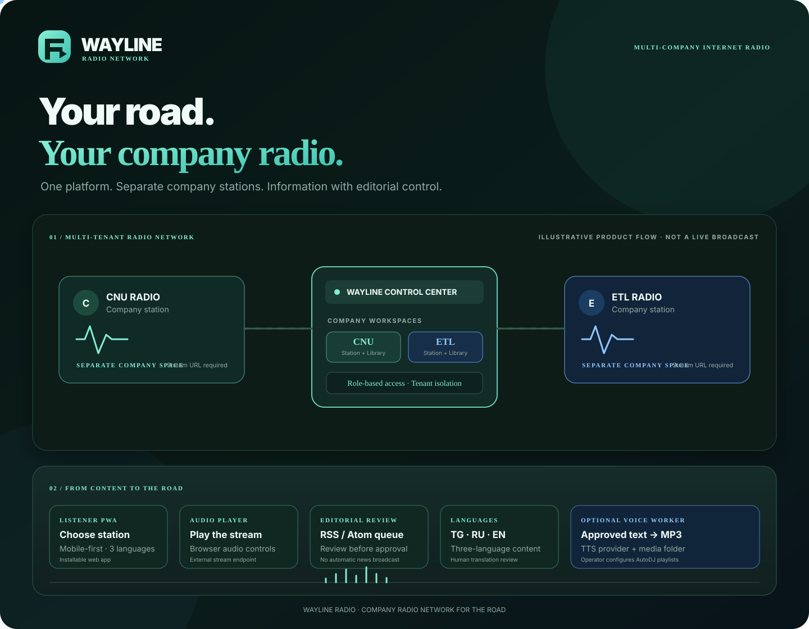

<div align="center">


# WAYLINE RADIO

### Your road. Your company radio.

**A multilingual, multi-company internet radio platform for trucking and logistics teams.**

[](https://nodejs.org/)
[](https://www.postgresql.org/)
[](https://www.docker.com/)
[](#listener-experience)
[](LICENSE)

[Quick start](#quick-start) · [Architecture](#how-the-platform-works) · [Features](#platform-capabilities) · [Deployment](docs/DEPLOYMENT.md) · [API](docs/API.md) · [Security](docs/SECURITY.md)

</div>

---

## Product showcase

<p align="center">
  
</p>

<p align="center"><sub>Animated product illustration. It explains the platform architecture and workflow; it is not a live dashboard or proof of an active broadcast.</sub></p>

## What is WAYLINE RADIO?

WAYLINE RADIO is a software foundation for operating separate internet radio stations for multiple trucking and logistics companies from one controlled platform.

Each company has its own station, music metadata, information sources and announcements. Drivers and team members use a lightweight, mobile-first listener app to choose their company station. Authorized staff use a central control center to manage station configuration, content workflows and broadcast-readiness records.

The project is designed around three principles:

1. **One network, separated companies.** Company data is scoped by server-verified membership.
2. **Useful information, human editorial control.** Collected RSS/Atom stories wait for review; they are not automatically broadcast.
3. **Rights before airtime.** A music track is not marked eligible until required rights declarations and proof references are recorded.

> **Honest status:** This repository is a deployable application foundation, not a hosted 24/7 radio service. Actual audio playback requires a configured public stream URL and an external streaming engine such as AzuraCast or Icecast.

## Platform capabilities

### Listener experience

- Public station directory backed by the API, with local demo station settings as a fallback.
- Company station selection and browser audio playback for a configured stream URL.
- English, Russian and Tajik interface.
- Installable Progressive Web App manifest and service worker.
- Mobile-first layout for use on the road.
- Company announcements can be displayed from approved local workspace data.

### Company control center

- Overview of companies, stations, music tracks and pending information.
- Separate company workspaces and station configuration.
- Local demo mode for trying the dashboard without a connected API.
- API connection and administrator sign-in.
- Music library metadata and category management.
- RSS/Atom information source management and editorial review queue.
- Three-language company announcements.
- Rights and licensing status controls.

### Platform backend

- Node.js HTTP API and PostgreSQL persistence.
- Company, membership, role, station, track, source, information, announcement and audit-log data model.
- Short-lived HMAC-signed sessions and scrypt password hashing.
- Server-side company membership enforcement on administrative requests.
- Parameterized SQL queries and login throttling.
- Public station endpoints and health check.

### Information and voice workflow

```text
HTTPS RSS / Atom source
          │
          ▼
     Feed collector
          │
          ▼
    Pending review queue
          │
          ▼
 Human review + TG / RU / EN translations
          │
          ▼
       Approval
          │
          ▼
 Optional configured text-to-speech provider
          │
          ▼
  Language-specific MP3 files
          │
          ▼
 Operator maps media folders to AutoDJ playlists
          │
          ▼
    External radio stream
```

- The collector polls configured HTTPS RSS/Atom sources (five-minute default interval).
- New stories enter a pending review queue.
- Editors review source terms, factual accuracy, suitability and translations.
- Approved, fully translated items can be converted into one MP3 per language when a TTS provider is configured.
- Generated files are written to company/language folders for an operator to map into the media server's playlists.

**No story is automatically approved or put on air by the collector.** Translation is supplied and reviewed by an editor; an automatic translation service is not bundled.

## Music rights and broadcast eligibility

WAYLINE records the metadata needed for a rights-review workflow:

- Artist, composer and rights holder.
- License type, original source and proof reference.
- Commercial broadcast permission.
- Internet streaming permission.
- License expiry date.
- Audio URL.

The software gate requires the configured rights flags, proof and validity checks before a track is considered eligible. This is an administrative control, **not legal certification**: a person must still review the actual license document, territory, permitted use and term.

See [LICENSE-MUSIC.md](LICENSE-MUSIC.md).

## How the platform works

| Layer | Technology | Responsibility |
|---|---|---|
| Listener | HTML, CSS, vanilla JavaScript, PWA | Station directory, language selection and stream playback |
| Admin | HTML, CSS, vanilla JavaScript | Company operations, content review and configuration |
| API | Node.js 20+ | Authentication, tenant authorization and business endpoints |
| Database | PostgreSQL | Company-separated operational records |
| Collector / worker | Node.js | RSS/Atom intake and optional TTS audio generation |
| Streaming engine | External AzuraCast / Icecast-compatible service | Actual live audio delivery and AutoDJ |

## Quick start

### Requirements

- Node.js 20 or newer.
- PostgreSQL.
- Docker and Docker Compose (recommended for the complete local stack).
- A strong database password and a random JWT secret of at least 32 characters.

### Run with Docker Compose

```bash
git clone https://github.com/Khayom1/WAYLINE-RADIO.git
cd WAYLINE-RADIO
cp .env.example .env
```

Edit `.env` and set at minimum:

- `POSTGRES_PASSWORD` — a strong database password.
- `JWT_SECRET` — a cryptographically random secret with at least 32 characters.

Start the services:

```bash
docker compose up --build -d
```

Open:

- Listener app: **http://localhost:8080/**
- Control center: **http://localhost:8080/admin**

Create the first platform administrator:

```bash
docker compose exec api node scripts/create-admin.mjs
```

Open the control center, select **Connect API**, and sign in with the administrator credentials. The dashboard also has an isolated local demo mode.

### Development without Docker

Set up PostgreSQL and configure the environment variables described in `.env.example`, then:

```bash
npm install
npm start
```

Run the collector in a separate process:

```bash
npm run worker
```

The database can be hosted remotely; a mobile device does not need to run PostgreSQL locally.

## Android and Termux

Termux is suitable for repository inspection and Node.js development. The complete backend still requires a reachable PostgreSQL instance.

```bash
pkg update
pkg install git nodejs
git clone https://github.com/Khayom1/WAYLINE-RADIO.git
cd WAYLINE-RADIO
npm install
```

Configure `DATABASE_URL` and `JWT_SECRET` for a reachable PostgreSQL database before starting the API:

```bash
npm start
```

For a mobile-only frontend preview without the API, serve the static web app from `apps/web`:

```bash
cd apps/web
python -m http.server 8080 --bind 127.0.0.1
```

Open **http://127.0.0.1:8080**. In this static preview, API-backed public station loading and authenticated administration are unavailable; the dashboard's local demo mode remains available.

## Real radio streaming setup

WAYLINE does **not** bundle a streaming server, AutoDJ engine, licensed music catalogue or live stream URL.

To deliver actual continuous audio:

1. Deploy an external media platform such as AzuraCast with an Icecast-compatible public stream.
2. Create and test a separate station and AutoDJ configuration for each company.
3. Configure each WAYLINE station's `stream_url` with its public listener URL.
4. Add only media that has passed the required rights review.
5. Test each stream from a mobile network before describing it as live.

The listener app enables playback only when a valid HTTP(S) stream URL is configured. A configured URL alone does not guarantee that the stream is reachable or audible.

See [the deployment and radio-engine guide](docs/DEPLOYMENT.md).

## API overview

Base path: `/api/v1`.

| Area | Endpoint | Purpose |
|---|---|---|
| Health | `GET /health` | API and database health |
| Public stations | `GET /public/stations` | Active public station directory |
| Public station | `GET /public/stations/:slug` | Station details and configured stream URL |
| Authentication | `POST /auth/login` | Sign in and receive a short-lived token |
| Admin dashboard | `GET /admin/dashboard` | Company-scoped overview |
| Companies | `GET/POST /admin/companies` | Company administration (creation is platform-admin only) |
| Stations | `GET/PATCH /admin/stations` | Station configuration |
| Music | `GET/POST/DELETE /admin/tracks` | Track metadata and rights records |
| Sources | `GET/POST/PATCH /admin/sources` | RSS/Atom source configuration |
| Information | `GET/PATCH /admin/information` | Review and process collected stories |
| Announcements | `GET/POST/PATCH /admin/announcements` | Multilingual company announcements |

Admin requests require a bearer token and an `X-Company-ID` header. The server verifies the user's role and membership for the selected company; a client-supplied company ID is not treated as authorization.

Full endpoint details: [docs/API.md](docs/API.md).

## Security model

Implemented safeguards include:

- Scrypt password hashing with per-user random salts.
- HMAC-signed, expiring admin sessions.
- Server-side company membership checks on every admin request.
- Parameterized SQL queries.
- Login-attempt throttling.
- HTTPS-only RSS/Atom source validation, redirect rejection, and feed size/time limits.
- Request body size limits and audit-log records.
- No database credentials, JWT secrets or media-server API keys in frontend code.

Production deployment still requires TLS termination, restricted database networking, secret rotation, backups, monitoring, and infrastructure-level egress controls. Review [docs/SECURITY.md](docs/SECURITY.md).

## Configuration boundaries

| Component | Status |
|---|---|
| Listener PWA and admin control center | Included |
| API and PostgreSQL schema | Included |
| Local demo mode | Included |
| RSS/Atom collector and review queue | Included |
| Rights metadata and software eligibility gate | Included |
| Optional TTS worker adapter | Included; provider credentials required |
| External streaming server / AutoDJ | Must be deployed and configured separately |
| Real music catalogue and broadcast permissions | Must be supplied by the operator |
| Domain, TLS certificate, backups and monitoring | Production operator responsibilities |
| Automatic translation provider | Not bundled |
| Hosted public radio service | Not included |

The optional TTS adapter is provider-dependent. The current deployment guide documents a temporary Speech API model integration that must be reviewed and migrated before the provider's stated retirement date. Do not assume the optional voice pipeline is enabled in a fresh deployment.

## Quality checks

```bash
npm install
npm run check
npm test
```

CI runs the repository's configured checks. Passing automated tests does not replace deployment validation, rights review, mobile playback testing or external stream monitoring.

## Repository map

```text
WAYLINE-RADIO/
├── apps/
│   ├── api/                 # Node.js API and policy checks
│   ├── web/                 # Listener PWA and admin control center
│   └── worker/              # RSS collector and optional TTS worker
├── database/
│   └── migrations/          # PostgreSQL schema
├── docs/                    # Architecture, API, deployment, security
├── infrastructure/          # Deployment integration placeholders
├── scripts/                 # Admin setup and utilities
├── tests/                   # Automated tests
├── docker-compose.yml
├── Dockerfile
├── package.json
├── REQUIREMENTS.md
├── LICENSE
└── LICENSE-MUSIC.md
```

## License

The software is licensed under the [MIT License](LICENSE). This does not grant rights to music, recordings, RSS content, trademarks, logos or other third-party material. See [LICENSE-MUSIC.md](LICENSE-MUSIC.md).

## Maintainer

**Khayom Abdurahmonov** · [@Khayom1](https://github.com/Khayom1)

[Repository](https://github.com/Khayom1/WAYLINE-RADIO) · [Issues](https://github.com/Khayom1/WAYLINE-RADIO/issues)

<div align="center">

**WAYLINE RADIO — YOUR ROAD. YOUR COMPANY RADIO.**

*Built for the people who keep the road moving.*

</div>
